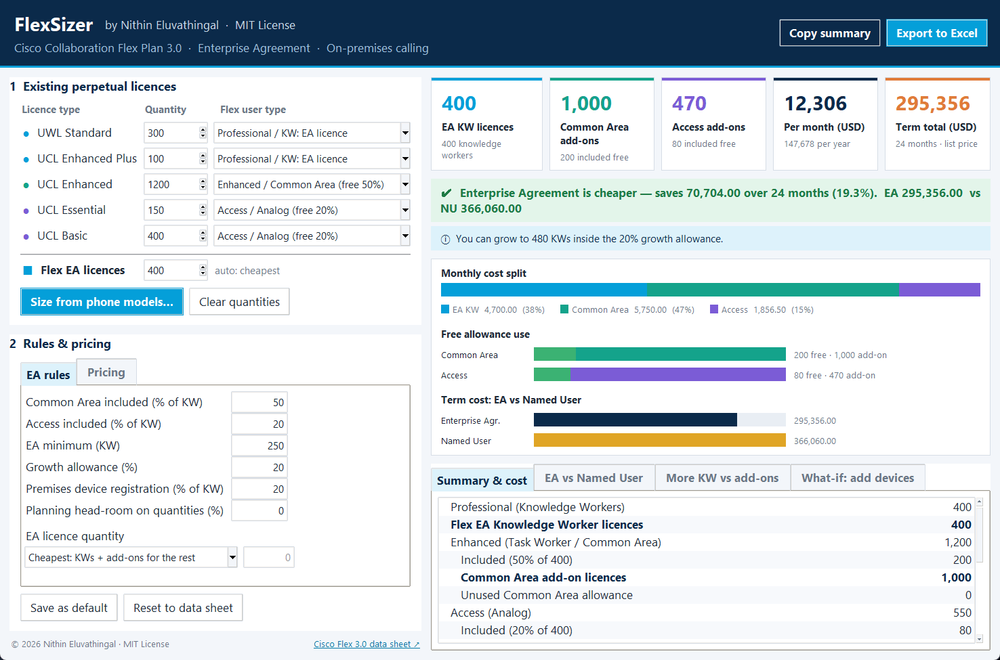

# FlexSizer — Cisco Collaboration Flex 3.0 EA sizing

*by Nithin Eluvathingal — MIT Licensed*

FlexSizer turns a customer's existing perpetual CUCM licences (UWL Standard, UCL Enhanced Plus,
Enhanced, Essential and Basic) into a **Cisco Collaboration Flex Plan 3.0 Enterprise Agreement**
for on-premises calling. It works out how many EA licences to buy, how many Common Area and Access
add-ons you need after the free allowance, and what it all costs per month and over the term. It also
prices the same users on the **Named User** model and tells you which one is cheaper.

## Run it

1. Install **Python 3.9 or newer** (Tkinter is included).
2. Optional: `py -m pip install openpyxl` for **Export to Excel**.
3. Double-click `run_app.bat`, or run `py flex_ea_app.py`.

Everything else uses the Python standard library. Pillow is only needed to redraw the icon with `make_icon.py`.

## How licences are counted

Existing licences map to Flex user types using Cisco's migration table. You can change the mapping per row.

| Existing licence | Flex user type | In the EA |
|---|---|---|
| UWL Standard, UCL Enhanced Plus | Professional (Knowledge Worker) | 1 EA licence each (A-FLEX-EAPL) |
| UCL Enhanced | Enhanced (Task Worker / Common Area) | Free up to 50% of the EA count, then Common Area add-on (A-FLEX-PL-COMMON) |
| UCL Essential, UCL Basic | Access (Analog) | Free up to 20% of the EA count, then Access add-on (A-FLEX-PL-ACCESS) |

EA rules from the [Flex 3.0 data sheet](https://www.cisco.com/c/en/us/products/collateral/unified-communications/cisco-collaboration-flex-plan/collaboration-flex-plan3-data-sheet.html)
(all editable on the **EA rules** tab):

- The EA covers all knowledge workers, with a minimum of **250**.
- Common Area devices are included at **50%** and Access licences at **20%** of the EA count.
- Growth allowance: **20%**. That's what CCW actually deposits as A-FLEX-P-EA smart licences; the data sheet says 15%.
- Premises device registration is included for **20%** of the EA count.

## EA licence quantity

Pick how many EA licences to buy on the **EA rules** tab, or type a number in **Flex EA licences** on the main panel.

| Option | What it does |
|---|---|
| Cheapest: KWs + add-ons for the rest | EA licences for knowledge workers only (minimum 250); everything else is an add-on. The default. |
| Match free allowance: no add-ons | Enough EA licences for the free 50% / 20% to cover every device. |
| Fewest EA licences with no add-ons | No add-ons, but spare EA licences also carry devices, so fewer than "Match". |
| Manual EA quantity | Your own number, down to the EA minimum. Knowledge workers above it are priced as Named User Professional and flagged: Cisco normally wants the EA to cover all knowledge workers. |

## EA vs Named User

Named User licenses every user and device one-to-one in its own tier (A-FLEX-NUPL-P Professional,
A-FLEX-NUPL-E Enhanced, A-FLEX-NUPL-A Access), with no minimum, no growth allowance and no free
allowance. The green strip under the tiles says which model is cheaper and by how much, and the
**EA vs Named User** tab compares them line by line. Sites with few knowledge workers usually favour
Named User; large estates with many Enhanced or Access devices usually favour the EA.

## Size from phone models

**Size from phone models…** suggests the licence types from the phones each user has, using Cisco's
UCL descriptions. Model names and part numbers both work (`9811`, `CP-9811-K9`, `DP-9841-K9`, `7942`).

| Phones / devices per user | Licence |
|---|---|
| Analog phone or fax, ATA 186/187/190/191, 3905, 6901 | UCL Essential |
| 6911, 6921, 9811 | UCL Basic |
| 3911, 3951, 6941/6945/6961, 79xx, 89xx, 9841/9851/9861/9871, 99xx, E20, EX60/EX90, third-party SIP | UCL Enhanced |
| 2 devices (two phones, or a phone + Jabber/Webex) | UCL Enhanced Plus |
| 3 to 10 devices | UWL Standard (CUWL) |
| TelePresence SX/MX/TX/IX, Profile, Webex Room/Board | TelePresence Room: included in Flex |
| CTI route points / ports | Covered by EA knowledge-worker licences (UCL Enhanced under Named User) |

Models that aren't in Cisco's list are sized as UCL Enhanced, shown in orange, and can be changed.

## Pricing

Default prices are **USD list prices per licence per month** taken from CCW quotes in October/November 2026:

| SKU | Price |
|---|---|
| A-FLEX-EAPL (EA knowledge worker) | 11.75 |
| A-FLEX-PL-COMMON (Common Area add-on) | 5.75 |
| A-FLEX-PL-ACCESS (Access add-on) | 3.95 |
| A-FLEX-NUPL-P (NU Professional) | 10.95 |
| A-FLEX-NUPL-E (NU Enhanced) | 7.25 |
| A-FLEX-NUPL-A (NU Access) | 3.95 |

Change them, the discounts and the term on the **Pricing** tab, and check them against your own CCW quote.
**Save as default** keeps your rules and prices in `%APPDATA%\FlexSizer\settings.json`.

## Other tabs and outputs

- **Summary & cost**: every count and the monthly, yearly and term cost per SKU.
- **More KW vs add-ons**: the cost of buying more EA licences, matching the free allowance, or a smaller EA.
- **What-if: add devices**: the cost of adding knowledge workers, Common Area or Access devices.
- **Copy summary** puts a plain-text summary on the clipboard; **Export to Excel** writes a workbook with the sizing, the EA vs Named User comparison and the options table.

## Files

| File | Purpose |
|---|---|
| `flex_ea_app.py` | GUI (Tkinter) |
| `flex_ea_calc.py` | sizing, pricing and phone-model rules (no UI) |
| `run_app.bat` | starts the app without a console window |
| `app.ico`, `make_icon.py` | app icon and the script that draws it |
| `docs/screenshot.png` | screenshot for this page |

## Disclaimer

FlexSizer is an independent planning tool and is not made or endorsed by Cisco. Licensing rules and
prices change, so confirm the final bill of materials in Cisco Commerce Workspace (CCW) or with your
distributor before quoting.

## License

MIT License - Copyright (c) 2026 Nithin Eluvathingal. See [LICENSE](LICENSE).
